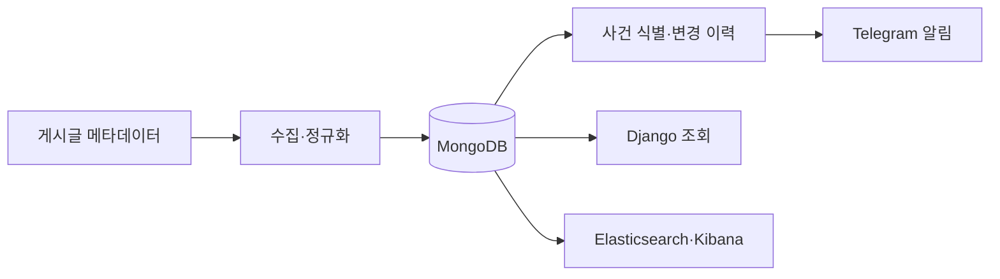

# 다크웹 위협정보 모니터링 · ISMS-P 자체 모의진단

다크웹 게시글의 신규·변경 여부를 추적하는 팀 개발 프로젝트입니다. 이후 개발한 시스템을 대상으로 **정보자산, 접근권한, 감사로그, 보유·파기 등 21개 ISMS-P 관련 통제**를 선별해 개인적으로 모의진단하고 GAP·개선계획·증적을 정리했습니다.

**프로젝트 구분:** 3인 팀 개발(2025.11~12) / 개인 후속 ISMS-P 모의진단  
**수행 범위:** 자체 구축한 모니터링 시스템과 학습용 관리체계 분석

[Notion 프로젝트 보기](https://app.notion.com/p/10ffef567359805dbd87fc484ec71789) · [시스템 설계](docs/architecture.md) · [검증 기록](docs/validation.md)

## 담당 작업과 시스템 구조

팀에서는 사이트별 **수집 크롤러**와 **Elasticsearch·Kibana 연계**를 담당했습니다. 프로젝트 시스템은 사건 중복·변경 이력을 구분하고 메타데이터를 저장하며, 조회 화면과 알림으로 연결합니다.



반복 수집된 동일 사건과 실제로 내용이 바뀐 사건을 구분하기 위해 `event_key`, `content_fingerprint`, 변경 이력을 분리했습니다. 알림 또한 신규·변경을 구별합니다.

[수집·변경 처리 코드](crawling/storage.py) · [알림 처리](alert/service.py) · [설계 설명](docs/architecture.md)

## ISMS-P 관점에서 확인한 문제

개인 후속 작업에서는 프로젝트 시스템의 자산 15개, 선정 통제 21개, 운영 위험 시나리오 12개를 연결해 **GAP Matrix, Risk Register, 개선계획과 증적 인덱스**를 작성했습니다.

| 검토한 문제 | 프로젝트에서 확인한 조치 |
| --- | --- |
| 일반 분석가와 감사 검토 담당자의 기능 구분 | Django 접근권한을 구분하고 일반 분석가의 검토 화면 접근을 제한 |
| 생성한 감사로그의 검토 방식 부재 | 최근 30일 감사로그를 읽기 전용으로 집계하고 주의 이벤트를 표시하는 Audit Review 구성 |
| 위험과 조치 근거의 연결 부족 | 자산·통제·위험 시나리오·처리계획·코드 및 시험 증적을 상호 참조 |

이는 **시스템 기능 보강 및 자체 모의진단** 결과이며, 조직의 권한 승인·정기 점검이나 ISMS-P 인증 적합성을 확인한 결과는 아닙니다.

## 주요 산출물

| 문서 | 확인할 내용 |
| --- | --- |
| [모의진단 범위](docs/isms_p/00_scope.md) · [자산대장](docs/isms_p/01_asset_inventory.md) | 분석에 포함한 시스템과 자산 |
| [데이터 흐름](docs/isms_p/02_data_flow.md) · [GAP Matrix](docs/isms_p/03_control_gap_matrix.md) | 정보 이동과 통제별 검토 결과 |
| [위험등록부](docs/isms_p/04_risk_register.md) · [위험 처리계획](docs/isms_p/05_risk_treatment_plan.md) | 가능성·영향 평가와 개선 우선순위 |
| [증적 인덱스](docs/isms_p/06_evidence_index.md) · [최종 평가](docs/isms_p/07_final_assessment.md) | 코드·테스트 근거와 남은 확인 사항 |

[시스템 실행 화면과 Excel 대시보드](https://app.notion.com/p/10ffef567359805dbd87fc484ec71789)

## 실행과 검증

```bash
python -m pip install -r requirements.txt
python -m unittest discover -v
python dashboard/manage.py test mongoDbConnect -v 2
python dashboard/manage.py check
```

환경 구성은 [`.env.example`](.env.example)을 참고하며 실제 인증정보는 저장소에 포함하지 않습니다. 기능 검증의 입력에는 오프라인 fixture와 합성 사건이 사용되므로 실시간 다크웹 침해 사실 검증과 구분합니다.

[테스트 범위와 실행 기록](docs/validation.md) · [운영 범위와 제한](docs/isms_p/07_final_assessment.md)
