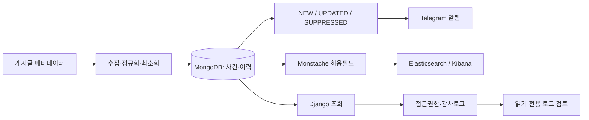

# 다크웹 위협정보 모니터링 및 ISMS-P 자체 모의진단

[](https://github.com/LEESJ7934/darkweb-threat-intelligence-monitor/actions/workflows/ci.yml)

**게시글의 메타데이터 관찰·변경 이력을 관리하는 팀 프로젝트**, 그리고 **해당 시스템을 대상으로 한 개인 후속 ISMS-P 모의진단**입니다.

> **범위:** 다크웹 게시글의 주장을 확인된 침해 사고로 확정하지 않습니다. 실제 피해자 데이터·자격증명 수집이나 고객사 인증심사가 아닌 팀 개발·자체 실습입니다.

**바로 보기:** [관리체계 대표 GAP 2건](docs/isms_p/recruiting-case-brief.md) · [실습 검증 기록](docs/validation.md) · [위험등록부 12개 시나리오](docs/isms_p/04_risk_register.md) · [모의 인터뷰·증적 질문](docs/isms_p/recruiting-mock-audit-interview.md) · [Notion 프로젝트](https://app.notion.com/p/10ffef567359805dbd87fc484ec71789)

## 1. 팀 프로젝트와 개인 후속 작업 구분

| 구분 | 범위 | 구분해야 하는 사항 |
|---|---|---|
| **3인 팀 개발** (2025.11~12) | 게시글 수집, MongoDB 저장·이력, Django 조회, 알림, ELK 연계로 구성된 시스템. **본인 담당으로 기록된 부분:** 사이트별 크롤러 개발과 Elasticsearch·Kibana 연계 | 시스템 전체 기능을 본인 단독 개발로 표현하지 않음 |
| **개인 후속 모의진단** | 시스템 자산·데이터 흐름을 기준으로 관련 ISMS-P 통제 **21개 항목을 선별**, 자산 15개·위험 시나리오 12개와 GAP·대책·증적 연결 | ISMS-P 전체 인증심사나 실제 조직의 공식 적합 판정이 아님 |
| **후속 코드·운영 통제 보강** | 접근권한 구분, 로그 검토, 알림·보유기간 안전성 등 저장소에서 확인되는 개선 기능 | 변경의 정확한 개인별 기여도는 역할 기록과 커밋 근거로 별도 확인하며, 구현된 기능을 실제 운영 승인과 혼동하지 않음 |

## 2. 데이터가 어떻게 처리되는가



| 설계 요소 | 이유 | 근거 |
|---|---|---|
| `event_key`·`content_fingerprint`·변경 이력 | 재수집과 내용 변경을 구별하고 중복 사건을 줄이기 위해 | [`crawling/storage.py`](crawling/storage.py) · [설계 문서](docs/architecture.md) |
| `NEW / UPDATED / SUPPRESSED` 알림 관리 | 중복 발송·재시작·비중요 변경을 구분하기 위해 | [`alert/service.py`](alert/service.py) |
| Django 접근권한 | 일반 분석가와 감사 검토 관리자 기능을 구분하기 위해 | [`governance/`](governance/) |
| 허용 필드만 검색으로 전달 | 불필요한 내부 필드 전파를 줄이기 위해 | [`monstache/`](monstache/) · [증거](docs/validation.md) |

**검증 범위:** 현재 자동 스케줄 수집 대상은 README 기록상 Bitlock 한 곳이며, 다른 크롤러는 오프라인 파서·fixture 검증 범위가 포함됩니다. 현재 다크웹 사이트 가용성·모든 침해 사실을 보장하지 않습니다.

## 3. ISMS-P 자체 모의진단: 대표 GAP 2건

모의진단 과정은 **범위 → 자산 15개 → 데이터 흐름 → 21개 선정 통제 → GAP → 위험 시나리오 12개 → 개선·증적 → 재평가**입니다.

| 확인한 GAP | 프로젝트에서 개선한 기능 | 여전히 부족한 증거 |
|---|---|---|
| 일반 Analyst와 감사 검토 관리 기능의 권한 구분 미흡 | Django `is_staff` 기반 Security Admin만 감사 검토 기능 접근; 일반 분석가는 거부 응답 | MFA, 실제 조직의 계정·권한 정기 검토 이력 |
| 감사로그를 만들지만 정기 검토 기준·도구 부족 | 최근 30일 `audit.jsonl*`를 read-only 집계, 이상 이벤트 `ATTENTION` 표시 | 중앙/WORM 로그 보호, 조직 검토·승인/조치 기록, 자동 경보 |

**기능 구현과 관리체계 적합 여부는 다릅니다.** `IMPLEMENTED`는 소프트웨어 보강을 의미하고, 해당 ISMS-P 통제를 실제 조직 운영까지 포함하여 완전히 충족했다는 뜻은 아닙니다. 백업·복원 시험(R-06)과 MFA(R-02), 조직 침해사고 훈련(R-11)은 미완료입니다.

상세: [모의진단 범위](docs/isms_p/00_scope.md) · [GAP Matrix](docs/isms_p/03_control_gap_matrix.md) · [위험대장](docs/isms_p/04_risk_register.md) · [처리계획](docs/isms_p/05_risk_treatment_plan.md) · [증적 인덱스](docs/isms_p/06_evidence_index.md) · [최종 평가](docs/isms_p/07_final_assessment.md)

## 4. 검증 방법과 실행

```bash
python -m pip install -r requirements.txt
python -m unittest discover -v
python dashboard/manage.py test mongoDbConnect -v 2
python dashboard/manage.py check
```

추가 서비스 연동 시에는 [`.env.example`](.env.example) 및 [`scripts/check_runtime_config.py`](scripts/check_runtime_config.py)를 참고하고, 인증정보는 버전 관리에 포함하지 않습니다.

**기존 CI 기록:** 2026-11-09 실행에서 Python 단위 테스트 275개·Django 테스트 81개 통과로 README에 기록되어 있습니다. 별도의 [검증 이력 문서](docs/validation.md)에 표시된 266개·77개 등은 이전 실행시점의 숫자이며 이번 수정안을 위해 테스트를 다시 실행한 것은 아닙니다. 합성 데이터 기능 검증과 실제 외부 서비스 통합 시험을 구분합니다.

## 5. 운영 범위와 한계

- 다크웹 게시글에 적힌 '유출 주장'을 확인된 피해 사실로 간주하지 않습니다.
- 개인정보의 법적 처리 근거 및 보유·파기 적법성을 최종 판단하지 않았습니다.
- 실제 조직의 MFA·정기 권한검토·중앙 로그 보존·백업 복원·사고대응 훈련을 수행하지 않았습니다.
- 합성 이벤트·테스트 화면을 실사고 건수나 현재 운영 모니터링 성과로 확대하지 않습니다.
- 타인 및 외부 기관의 개인정보·비밀정보가 포함된 로그나 원본을 공개하지 않습니다.

[아키텍처](docs/architecture.md) · [검증 원문](docs/validation.md) · [ISMS-P 최종 평가](docs/isms_p/07_final_assessment.md) · [Notion 상세 포트폴리오](https://app.notion.com/p/10ffef567359805dbd87fc484ec71789)
