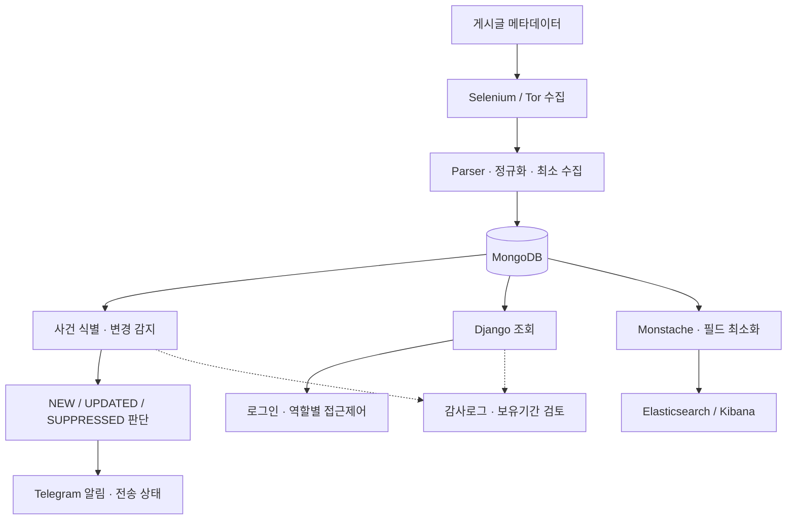
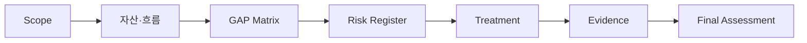

# 다크웹 위협 인텔리전스 모니터
**Darkweb Threat Intelligence Monitor**

다크웹 게시글의 **필요한 메타데이터만 수집**해 사건의 재관찰·변경 이력을 관리하고, 알림·조회·분석 기능에 **접근통제·감사·보유기간 검토**를 연결한 프로젝트입니다.

| 구분 | 내용 |
|---|---|
| 수행 구분 | 팀 프로젝트(2025.11–12) / 이후 자체 모의진단·후속 개선 |
| 주요 기술 | Python, Selenium, Tor SOCKS, MongoDB, Django, Telegram, Monstache, Elasticsearch, Kibana |
| 검증 기록 | Django 테스트 81 PASS(기록 기준), 로그인·알림·ELK 통합 시나리오 확인 |
| 관리체계 산출물 | 정보자산 15개, 선정 ISMS-P 통제항목 21개, 시스템 운영 위험 12개 |

## 시스템 아키텍처

이 구조는 실제 코드의 **데이터 흐름 및 통제 위치**를 나타냅니다. 수집과 조회·알림·검색은 하나의 직렬 처리 단계가 아닙니다.

## 구현과 설계 판단

| 영역 | 구현 내용 | 확인할 코드·근거 |
|---|---|---|
| 수집 · 정규화 | 수집기와 파서 분리, 메타데이터 allowlist, redaction | `crawling/` |
| 사건 이력 | `event_key`·`content_fingerprint`로 재관찰과 실제 내용 변경 구별 | `crawling/`, `docs/architecture.md` |
| 알림 처리 | NEW/UPDATED/SUPPRESSED, 중복 방지·전송 상태 관리 | `alert/` |
| 조회 · 권한 | Django 로그인, Analyst/Security Admin 권한 구분 | `DjangoProject/`, `governance/` |
| 검색 · 분석 | MongoDB에서 허용 필드만 ELK에 투영 | `monstache/`, `elk/` |
| 운영 통제 | 감사로그 점검, retention DRY RUN, 설정·비밀정보 점검 | `governance/`, `scripts/` |

현재 자동 스케줄 대상은 **Bitlock 1개**입니다. 나머지 파서는 오프라인 재현·테스트용입니다. 게시글의 유출 주장은 **확인된 침해 사실이 아니며**, 원문 유출 파일·계정·비밀번호를 수집하거나 재사용하지 않습니다.

## ISMS-P 통제항목 기반 자체 모의진단

실제 인증심사가 아닌 **프로젝트 범위의 자체 모의진단**입니다. 시스템 자산·데이터 흐름을 토대로 관련 통제항목을 선정하고, GAP과 위험평가를 증적·개선계획에 연결했습니다.

**대표 GAP:** Analyst/Admin 권한 구분 부족 → 역할 분리, 감사로그 정기 검토 기준 부족 → 최근 30일 Audit Review 기능 보완. MFA·정기 권한 검토·조직 승인 증거가 없는 항목은 **PARTIAL 또는 GAP**으로 남겼습니다.

<b>모의진단 산출물 8종 보기</b>

| 순서 | 문서 | 내용 |
|---|---|---|
| 00 | [Scope](docs/isms_p/00_scope.md) | 진단·제외 범위 |
| 01 | [Asset Inventory](docs/isms_p/01_asset_inventory.md) | 정보자산 15개 |
| 02 | [Data Flow](docs/isms_p/02_data_flow.md) | 데이터 흐름·신뢰 경계 |
| 03 | [GAP Matrix](docs/isms_p/03_control_gap_matrix.md) | 관련 통제항목 21개 |
| 04 | [Risk Register](docs/isms_p/04_risk_register.md) | 위험 시나리오 12개 |
| 05 | [Treatment Plan](docs/isms_p/05_risk_treatment_plan.md) | 개선 과제·잔여위험 |
| 06 | [Evidence Index](docs/isms_p/06_evidence_index.md) | 통제별 코드·검증 근거 |
| 07 | [Final Assessment](docs/isms_p/07_final_assessment.md) | 개선 후 재평가·한계 |

## 검증과 기술 문서

- [아키텍처와 주요 설계 판단](docs/architecture.md) · [단위·통합 검증 및 한계](docs/validation.md)
- [통제항목별 근거](docs/isms_p/06_evidence_index.md) · [프로젝트 사고 대응 절차](governance/incident_response.md)
- [CI 워크플로](.github/workflows/ci.yml) · [Kibana 대시보드 구성 파일](elk/kibana_dashboard.ndjson)

검증 기록은 수행한 환경·시점에 한정됩니다. 모든 다크웹 소스의 현재 가용성, 법률 준수, ISMS-P 인증 적합성을 보장하지 않습니다.
