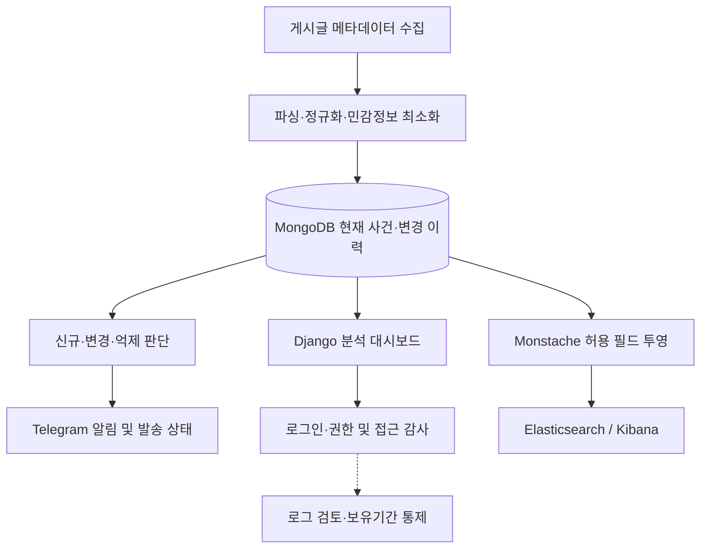

# 다크웹 위협정보 모니터링 및 보안 통제 점검

[](https://github.com/LEESJ7934/darkweb-threat-intelligence-monitor/actions/workflows/ci.yml)

다크웹 게시글에서 **필요한 메타데이터만 수집**하고, 동일 사건의 재관찰과 내용 변경을 구분해 알림·조회·검색으로 연결한 프로젝트입니다. 후속 작업에서는 데이터 흐름을 바탕으로 **접근통제, 감사로그, 보유기간, ISMS-P 통제항목별 증적과 개선 과제**를 점검했습니다.

**먼저 확인하기:** [시스템 설계](docs/architecture.md) · [테스트 및 실제 통합 검증](docs/validation.md) · [ISMS-P 자체 모의진단 결과](docs/isms_p/07_final_assessment.md) · [통제별 증적](docs/isms_p/06_evidence_index.md)

## 핵심 구현과 검증 결과

| 구분 | 결과 |
| --- | --- |
| 사건 식별·변경 추적 | `event_key`와 콘텐츠 지문을 사용해 동일 관찰과 변경 이력 구별 |
| 알림 처리 | `NEW / UPDATED / SUPPRESSED` 구분, 중복 발송 방지 및 전송 상태 관리 |
| 조회·검색 | Django 인증 기반 대시보드, MongoDB 조회, Monstache를 통한 Elasticsearch/Kibana 검색 |
| 보안 통제 | 역할별 접근 권한, 감사로그 검토, 데이터 최소화, 보유기간 DRY RUN |
| 자체 모의진단 | 정보자산 **15개**, 선정 ISMS-P 관련 통제항목 **21개**, 위험 시나리오 **12개** |
| 자동 테스트 | [2026-11-09 CI](https://github.com/LEESJ7934/darkweb-threat-intelligence-monitor/actions/runs/42602701149) 기준 Python 테스트 **275개**, Django 테스트 **81개** 통과 |

ISMS-P 결과는 **자체 모의진단**이지 공식 인증이나 외부기관 심사 결과가 아닙니다. 실제 침해 사실을 확인하거나 유출 원문·계정·비밀번호를 수집하는 시스템도 아닙니다.

## 개발 배경과 작업 범위

- **팀 프로젝트 (2025.11~12):** 크롤러·MongoDB 저장·알림·Django 조회·ELK 분석 흐름을 기반으로 개발했습니다.
- **후속 확장:** 사건 식별·변경 추적, 알림 신뢰성, 데이터 최소화와 운영 통제를 개선하고 ISMS-P 관점에서 자산·흐름·위험·증적·개선 대책을 문서화했습니다.
- **설계 원칙:** 관찰한 게시글의 **주장**과 검증된 침해 **사실**을 구별하고, 재현 가능한 합성 테스트를 운영 데이터와 분리합니다.

기술 스택: **Python, Selenium, Tor SOCKS, MongoDB, Django, Telegram, Monstache, Elasticsearch, Kibana, Docker, GitHub Actions**.

## 시스템 흐름



| 설계 판단 | 적용 이유 | 코드·상세 근거 |
| --- | --- | --- |
| 수집·파싱·저장 분리 | 실제 Onion 접속 없이 HTML fixture로 파서를 반복 테스트 | [크롤러](crawling/) · [설계 판단](docs/architecture.md) |
| 사건 ID와 변경 이력 분리 | 게시글 재수집을 신규 사고로 중복 처리하지 않도록 제어 | [저장 처리](crawling/storage.py) |
| 알림 상태·재시도 관리 | 재시작·전송 실패 시 중복 발송과 유실 가능성을 줄임 | [알림 서비스](alert/service.py) |
| 대시보드 접근통제 | 미인증 접근을 차단하고 Security Admin의 감사 검토 권한을 분리 | [Django 화면](dashboard/) · [거버넌스](governance/) |
| 검색용 필드 제한 | 내부 운영 필드와 알림 전송 관련 정보가 검색 인덱스에 불필요하게 노출되지 않도록 함 | [Monstache 설정](monstache/) · [ELK](elk/) |

**현재 자동 스케줄 수집 대상은 Bitlock 하나**입니다. 다른 크롤러는 오프라인 파서 검증·재현 자료로 유지하며, 모든 다크웹 사이트의 현재 접근 가능성을 보장하지 않습니다.

## ISMS-P 자체 모의진단

단순히 통제항목 준수 여부를 표시하는 대신, **점검 범위 → 정보자산 → 데이터 흐름 → GAP → 위험평가 → 개선 대책 → 증적 → 재평가**를 연결했습니다.

| 확인된 GAP | 후속 조치 | 남은 한계 |
| --- | --- | --- |
| 일반 분석가와 관리 기능의 권한 구분 부족 | Django Analyst / Security Admin 권한 분리 | MFA·정기 권한 검토 미구현 |
| 감사로그의 정기 검토 기준 부재 | 최근 30일 로그에 대한 읽기 전용 Audit Review 구현 | 중앙 변조방지 저장·실제 조직 승인 이력 없음 |
| 운영 위험과 증적 연결 부족 | 위험대장·처리계획·통제별 증적 인덱스 작성 | 조직 차원의 위험 수용·인증 적합성 미검증 |

[진단 범위](docs/isms_p/00_scope.md) → [자산 목록](docs/isms_p/01_asset_inventory.md) → [데이터 흐름](docs/isms_p/02_data_flow.md) → [GAP 매트릭스](docs/isms_p/03_control_gap_matrix.md) → [위험대장](docs/isms_p/04_risk_register.md) → [개선계획](docs/isms_p/05_risk_treatment_plan.md) → [증적 인덱스](docs/isms_p/06_evidence_index.md) → [최종 평가](docs/isms_p/07_final_assessment.md)

## 로컬 테스트와 실행 전 확인

Python 3.12를 기준으로 저장소 루트에서 테스트할 수 있습니다.

```bash
python -m pip install -r requirements.txt
python -m unittest discover -v
python dashboard/manage.py test mongoDbConnect -v 2
python dashboard/manage.py check
```

실제 MongoDB·Telegram·Elasticsearch·Kibana와 연동하는 경우에는 [`.env.example`](.env.example)을 참고해 **로컬 전용 `.env`**에 필요한 연결 정보를 별도로 설정하고 [환경 검사 코드](scripts/check_runtime_config.py)로 확인해야 합니다. 운영 자격증명은 저장소에 커밋하지 않습니다. 웹 대시보드는 [`dashboard/manage.py`](dashboard/manage.py)를 사용하며, 실서비스 배포용 보안·인증·네트워크 구성을 별도로 검토해야 합니다.

## 검증 범위와 한계

- [자동 테스트·보안 점검](.github/workflows/ci.yml): 파서·저장·알림·거버넌스 테스트와 Django 점검을 실행합니다.
- [통합 검증 기록](docs/validation.md): Telegram 알림, 로그인/로그아웃, Monstache direct-read·change-stream·resume, Kibana 구성은 당시 통합 실습 결과입니다. 현재 외부 서비스 가용성을 의미하지 않습니다.
- 게시글 데이터의 신뢰도, 침해 사실, 개인정보 관련 법률 준수 여부를 자동 확정하지 않습니다.
- MFA, 정기 권한 검토, 중앙 감사로그 변조방지, 백업·복구 시험 등은 [미완료 개선 항목](docs/isms_p/07_final_assessment.md)에 남겨두었습니다.
- 프로젝트 코드·설계·진단 산출물은 학습용 및 자체 검증 환경을 기준으로 설명합니다. 운영 보안 서비스 또는 인증 획득 결과로 해석하지 않습니다.
