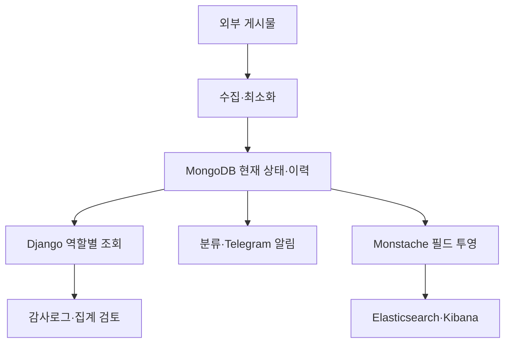
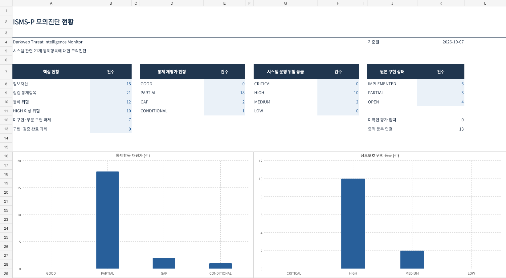
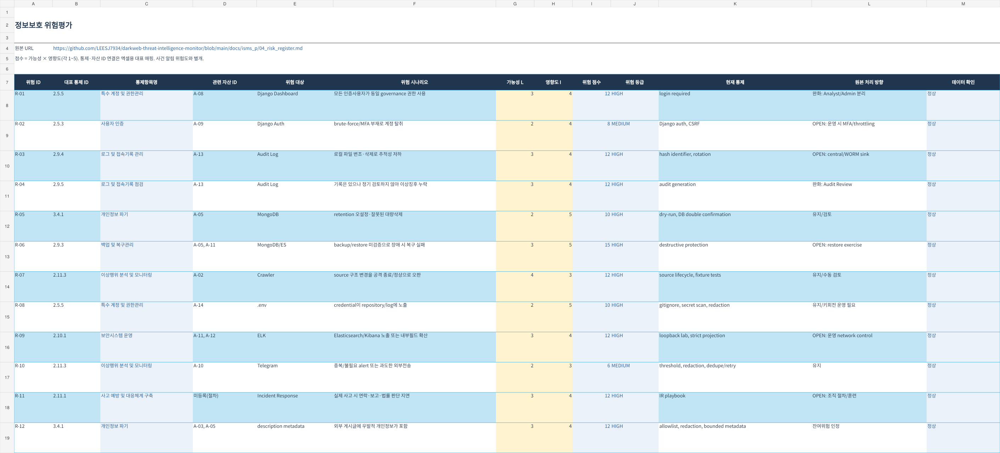
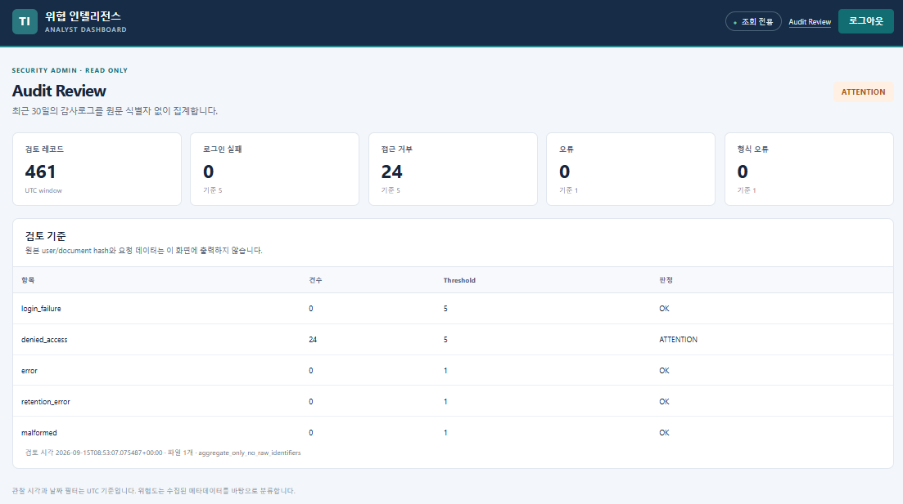

# 다크웹 위협정보 모니터링과 ISMS-P 모의진단
**Darkweb Threat Intelligence Monitor**

다크웹 유출 게시글의 **필요한 메타데이터만 수집**하고, 동일 사건의 재관찰과 내용 변경을 구분해 **알림·조회·분석·운영 보안 통제**로 연결한 프로젝트입니다. 게시글의 유출 주장은 검증된 침해 사실과 구분하며, 유출 원문 파일이나 계정·비밀번호를 수집·재사용하지 않습니다.

## 1. 프로젝트 개요

초기 수집·저장·조회 중심 구조에서 다음 과제를 식별했습니다.

- 같은 게시글이 다시 수집될 때 **중복과 재관찰**을 구분하기 어려움
- 게시글 내용이 바뀌면 **변경 전후 근거**를 추적하기 어려움
- 중요하지 않은 변경까지 알림으로 보내 **알림 피로**가 발생할 수 있음
- 데이터 조회·외부전송 과정에서 **불필요한 정보 노출** 가능성
- 접근권한·감사로그·보유기간 등 **운영 보안 통제**의 부족

**팀 프로젝트 기간은 2025.11~2025.12**입니다. 수집·저장·조회·알림 기반을 개선하고, 이후 프로젝트 범위에서 운영 통제 및 ISMS-P 자체진단 산출물을 보완했습니다. 후속 개선·검증을 초기 팀 프로젝트 기간의 공동 성과로 소급하지 않습니다. 세부 수행 이력은 [프로젝트 설명](docs/project_story.md)에 정리했습니다.

이 프로젝트는 **관리체계 점검의 판단 과정**을, [인프라 스캐너](https://github.com/LEESJ7934/infrastructure-security-scanner)는 **기술진단의 검증 과정**을 보여줍니다. [채용용 요약과 기존 화면](https://www.notion.so/10ffef567359805dbd87fc484ec71789)에서 대표 산출물을 확인할 수 있습니다.

## 2. ISMS-P 통제항목 기반 자체 모의진단

**교육·포트폴리오 목적의 자체 모의진단**으로, 실제 기업의 인증심사나 법률 준수 판정이 아닙니다. 시스템 구현 이후, **Scope → Asset → Data Flow → GAP → Risk → Treatment → Evidence → Final Assessment** 순서로 자체진단을 정리했습니다.

- **진단 범위:** 프로젝트에서 코드·설정·테스트 등으로 확인 가능한 **21개 관련 통제항목** 선별. 조직의 인사·물리보안 등은 제외
- **위험평가:** 별도 정보보호 위험 시나리오 **12개**를 등록하고 발생 가능성×영향도로 우선순위 평가
- **대표 GAP ① 접근권한:** 일반 Analyst와 Security Admin의 governance 기능 권한 구분 부족 → 최소 역할 분리
- **대표 GAP ② 로그 점검:** 감사로그는 존재하지만 정기 검토 기준·도구 부족 → 최근 30일 집계형 Audit Review 추가
- **재평가:** 개선 기능이 있더라도 MFA·정기 권한 검토·조직 승인 기록 등 미구현 요소가 있어 관련 항목을 **PARTIAL**로 유지
- **증적 관리:** 코드·설정·테스트 결과를 통제항목에 연결하고, **증명할 수 없는 영역**도 명시

| 순서 | 산출물 | 핵심 내용 |
|---|---|---|
| 00 | [Scope](docs/isms_p/00_scope.md) | 진단 대상과 제외 범위 |
| 01 | [Asset Inventory](docs/isms_p/01_asset_inventory.md) | 15개 정보자산·중요도 |
| 02 | [Data Flow](docs/isms_p/02_data_flow.md) | 데이터 이동·신뢰 경계 |
| 03 | [GAP Matrix](docs/isms_p/03_control_gap_matrix.md) | 관련 21개 통제의 현재 상태·GAP |
| 04 | [Risk Register](docs/isms_p/04_risk_register.md) | 12개 시스템 운영 위험 |
| 05 | [Treatment Plan](docs/isms_p/05_risk_treatment_plan.md) | 위험 처리·잔여위험 |
| 06 | [Evidence Index](docs/isms_p/06_evidence_index.md) | 근거자료와 증명 한계 |
| 07 | [Final Assessment](docs/isms_p/07_final_assessment.md) | 개선 후 재평가·남은 GAP |

### 왜 21개 항목인가

프로젝트 자산·흐름에 직접 연결되고 코드·설정·테스트 또는 미흡 사실을 확인할 수 있는 항목을 선정했습니다. 통제가 이미 구현된 항목만 고른 것은 아닙니다. 권한 정기검토·복원시험처럼 증적이 없는 항목도 GAP으로 포함했습니다. 조직 전체 인사·물리보안·경영진 승인과 제3자 피해기업은 범위 밖입니다. 개인정보 최소화는 수집·저장·전송 설계와 잔여위험으로 설명하며, 별도 통제항목을 점검했다고 추가 계산하지 않습니다.

| 판단 연결 | 실제 사례 | 근거 |
|---|---|---|
| 자산 → 흐름 | A-08 Django의 조회 경계 TB-05와 A-13 감사로그를 구분 | Asset Inventory / Data Flow |
| GAP → 위험 | 2.5.5 권한 과다 → R-01, 2.9.5 미검토 → R-04 | GAP Matrix / Risk Register |
| 위험 → 개선 | R-01 역할 분리, R-04 30일 Audit Review | Treatment Plan |
| 구현 → 증적 | Analyst 접근 403, Security Admin 조회, 집계 임계치 테스트 | [접근통제](governance/django_controls.py), [Django 테스트](DjangoProject/mongoDbConnect/tests_governance.py), [로그 점검](governance/audit_review.py) |
| 재평가 → 잔여위험 | 기능 개선 후에도 정기 권한검토·월간 승인 기록 부재로 PARTIAL | Final Assessment |

**위험평가 기준:** 가능성 1~5 × 영향도 1~5. 1~4 LOW, 5~9 MEDIUM, 10~15 HIGH, 16~25 CRITICAL의 프로젝트 상대평가입니다. 실제 경영진의 위험수용 기준이 아니며 각 점수의 조직별 정량 근거까지 검증한 것은 아닙니다. Treatment Plan의 잔여위험은 정성적 판단이며 측정된 감소율이 아닙니다. `alert/risk.py`의 게시물 우선순위와 별개입니다.

**운영 통제와 기능의 구분:** Audit Review 화면은 검토 도구가 동작함을 보여주지만 담당자가 정기 검토·승인했다는 증거는 아닙니다. retention DRY RUN은 삭제 대상을 검토하는 기능이며 법적 보유·파기 기준의 적정성을 증명하지 않습니다.

## 3. 전체 데이터 흐름



## 4. 핵심 기능과 정보보호 관점

| 영역 | 주요 구현·설계 | 정보보호 관점 |
|---|---|---|
| 수집·정규화 | Selenium/Tor, 필드 allowlist, redaction | 불필요한 수집·민감정보 노출 제한 |
| 사건 식별 | `event_key`, `content_fingerprint`, `leak_history` | 중복 식별, 변경 이력 및 추적 근거 |
| 알림 | NEW/UPDATED 구분, 위험도 분류, Telegram | 주요 이벤트 선별, 전송 상태 확인 |
| 조회 | Django 로그인, Analyst/Security Admin 역할 분리 | 비인가 접근 및 관리자 권한 제한 |
| 분석 | MongoDB → Monstache → Elasticsearch/Kibana | 분석용 필드 최소화, 조회 범위 관리 |
| 운영 | 감사로그·30일 검토 도구, retention DRY RUN | 로그 점검, 보유기간 및 안전한 삭제 검토 |

- `leaked_data`: 사건 현재 상태 / `leak_history`: 변경 이력 / `alert_log`: 알림·전송 상태
- 현재 자동 스케줄 대상은 **Bitlock 1개**입니다. 나머지 source parser는 오프라인 재현·테스트용으로 보관하며, 실제 위협 조직의 활동 종료를 뜻하지 않습니다.
- 프로젝트의 위험도 분류는 **수집 게시글의 우선 검토 수준**을 의미하며 실제 침해나 피해를 확정하지 않습니다.
- 상세 설계·트레이드오프는 [architecture.md](docs/architecture.md), 기능별 통제·증거·한계는 [control_matrix.md](governance/control_matrix.md)에 있습니다.

## 5. 검증과 한계

기존 프로젝트 문서에 기록된 검증 결과에는 **Django 테스트 81 PASS**, 설정·비밀정보 검사 PASS, MongoDB→ELK 동기화와 Django 로그인 흐름의 E2E PASS가 포함됩니다. 이 표기는 **기존 검증 기록**이며 이 문서 정리 과정에서 새로 실행한 결과는 아닙니다. 이전 Django 77 PASS 기록과의 시점 구분은 [검증 문서](docs/validation.md)에 명시했습니다.

중요한 한계:
- 모든 소스의 실시간 가용성, 향후 selector 동작, 완전한 개인정보·비밀정보 탐지를 보장하지 않습니다.
- MongoDB/ELK 정기 백업·복원 시험, 중앙 감사로그 무결성, MFA·정기 권한 검토, 조직 차원의 사고대응 훈련은 보완 과제입니다.
- 보유기간 기본값(`leaked_data`·`leak_history` 각 365일, `alert_log` 180일)은 **프로젝트 설정값**이며 법정 보유기간이 아닙니다.
- 프로젝트는 유출 원문 다운로드·자격증명 재사용·피해 시스템 접근·CAPTCHA 우회를 수행하지 않습니다.

## 6. 실행·기술 참고

주요 구성: Python 3.12, Django 5.2, MongoDB, Selenium, Tor SOCKS proxy, Docker Desktop, Elasticsearch 8.15.3, Kibana 8.15.3, Monstache 6.7.7, Telegram Bot API.

```powershell
python -m venv .venv
.\.venv\Scripts\Activate.ps1
python -m pip install -r requirements.txt
if (-not (Test-Path .env)) { Copy-Item .env.example .env }
python scripts/check_secrets.py
python scripts/check_runtime_config.py
```

실제 인증정보는 `.env`에만 저장하고 Git에 커밋하지 않습니다. 정식 Django 진입점은 `DjangoProject/manage.py`입니다.

- [검증 시나리오와 기록](docs/validation.md)
- [ELK 구성 및 재현 절차](elk/operations.md)
- [Kibana 대시보드 명세](elk/kibana_dashboard_spec.md)
- [데이터 처리·운영 정책](governance/data_handling.md)
- [프로젝트 사고 대응 절차](governance/incident_response.md)
- [기술 구조와 설계 판단](docs/architecture.md)

## 7. 재현·대표 화면

설정 후 단위 테스트와 Django 검증은 각각 실행합니다. 단위 테스트 성공만으로 외부 서비스 연동 완료를 판단하지 않습니다.

```powershell
python -m unittest discover -v
python DjangoProject/manage.py test mongoDbConnect -v 2
python DjangoProject/manage.py check
python DjangoProject/manage.py runserver 127.0.0.1:8000
```

Django 조회에는 구성된 MongoDB와 인증 계정이 필요합니다. MongoDB·Monstache·Elasticsearch·Kibana 구성은 [ELK 운영 절차](elk/operations.md)를 따릅니다. 실제 수집·알림 실행은 설정과 승인된 실습 환경을 확인한 뒤 수행하며 문서 점검 목적으로 외부 메시지를 보내지 않습니다.

### 대표 판단 근거


기존 Excel 화면(기준일 2026-10-07)의 정보자산 15개·통제항목 21개·위험 12개를 확인합니다. PARTIAL 18·GAP 2·CONDITIONAL 1은 프로젝트 자체 평가이며 인증 적합률이 아닙니다. 원본 구현 상태와 구현·검증 완료 상태를 구별합니다.


R-01 권한 과다, R-04 감사로그 미검토 등의 자산·통제·위험·처리 방향을 연결했습니다. 점수는 프로젝트 상대평가이며 측정된 조직 위험 감소율이 아닙니다. 작은 글자는 이미지를 열어 확대하거나 [Risk Register 원문](docs/isms_p/04_risk_register.md)으로 확인할 수 있습니다.


기존 검증 화면의 최근 30일 접근 거부 24건이 기준 5건을 넘어 ATTENTION으로 표시됩니다. 검토 기능 동작의 증거이며 담당자의 월간 검토·승인 완료 증거는 아닙니다.

Django 분석·사건 목록·Telegram·Kibana 화면은 [노션 기술적 기반 영역](https://www.notion.so/10ffef567359805dbd87fc484ec71789)에 보존했습니다. 당시 194건은 사건 메타데이터 조회 건수이며 침해 확정 건수·탐지 정확도·현재 운영량이 아닙니다. [공개 이미지 목록](docs/images/README.md)과 [검토 기록](docs/portfolio_review.md)을 함께 제공합니다.
